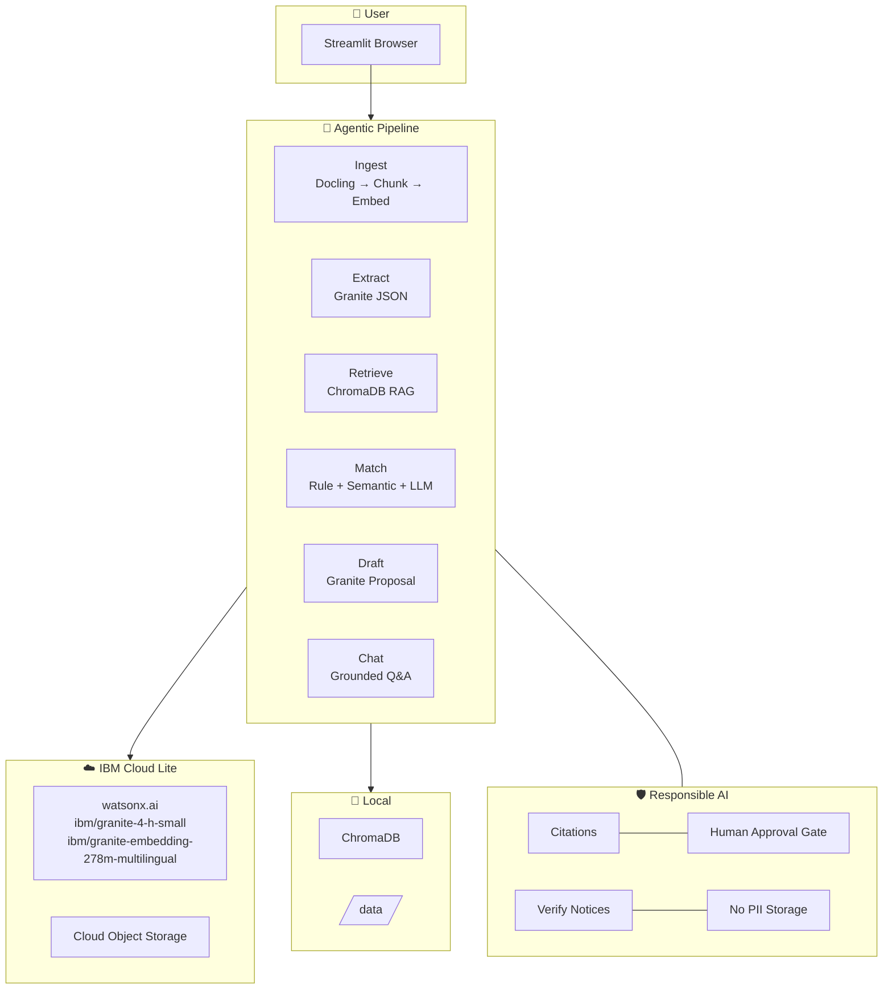

# 🔍 GrantScout — AI Grant & Funding Finder for Indian Startups

[](https://grant-scout.streamlit.app/)
[](https://www.ibm.com/watsonx)
[](https://python.org)
[](#)

> **Problem Statement #18 – AI Grant and Funding Finder for Startups**
> Built with IBM Granite on watsonx.ai (IBM Cloud Lite)

🌐 **Live App:** [https://grant-scout.streamlit.app/](https://grant-scout.streamlit.app/)

GrantScout is an **agentic RAG system** that helps Indian startups discover government grants, check eligibility, and draft applications — powered entirely by IBM Granite models and watsonx.ai on the free Lite tier.

---

## Architecture



See [docs/architecture.md](docs/architecture.md) for the full detailed diagram.

---

## Features

| Feature | Description |
|---------|-------------|
| 📂 **Ingestion** | Upload PDF/DOCX/HTML/TXT → Docling → chunks → Granite embeddings → ChromaDB |
| 🔍 **Extraction** | Granite extracts name, funding, deadline, eligibility into validated Pydantic JSON |
| 🎯 **Matching** | Hybrid: hard rules + semantic RAG + Granite reasoning → ranked match cards |
| ✍️ **Drafting** | Tailored proposal draft grounded in grant doc + startup profile; HITL approval gate |
| 💬 **Chat Q&A** | Grounded answers with doc+page citations; "not found" on empty retrieval |
| 🔬 **Agent Trace** | Every step (retrieve→extract→filter→score→draft) visible in the UI |
| 📊 **Evaluation** | Per-field extraction accuracy + matching precision@3; CSV + chart output |

---

## Quick Start

### Prerequisites
- Python 3.11+
- IBM Cloud account (free Lite tier): [cloud.ibm.com](https://cloud.ibm.com)
- watsonx.ai project created at [dataplatform.cloud.ibm.com](https://dataplatform.cloud.ibm.com)

### 1. Clone and install

```bash
cd GrantScout
pip install -r requirements.txt
```

### 2. Configure credentials

```bash
cp .env.example .env
# Edit .env with your IBM Cloud API key, watsonx URL, and project ID
```

Required variables in `.env`:
```
WATSONX_API_KEY=your_ibm_cloud_api_key
WATSONX_URL=https://us-south.ml.cloud.ibm.com
WATSONX_PROJECT_ID=your_watsonx_project_id
```

Get your API key from: IBM Cloud → Manage → Access (IAM) → API keys  
Get your project ID from: watsonx.ai → Projects → your project → Manage tab

### 3. Check which Granite models are available on your account

```python
from ibm_watsonx_ai import Credentials, APIClient
client = APIClient(Credentials(url="https://us-south.ml.cloud.ibm.com", api_key="YOUR_KEY"))
client.set.default_project("YOUR_PROJECT_ID")
# List foundation models
[m['model_id'] for m in client.foundation_models.get_model_specs()['resources'] if 'granite' in m['model_id'].lower()]
```

Then update `.env`:
```
GRANITE_INSTRUCT_MODEL=ibm/granite-4-h-small
GRANITE_EMBEDDING_MODEL=ibm/granite-embedding-278m-multilingual
```

### 4. Run the app

```bash
streamlit run app/streamlit_app.py
```

Open [http://localhost:8501](http://localhost:8501)

### 5. Quick test (no IBM credentials needed)

```bash
pytest tests/ -v
```

All tests mock IBM API calls — they run offline.

---

## Getting Grant Data

### Option A: Synthetic test data (instant)
Click **"📦 Load Synthetic Test Data"** in the Upload & Ingest tab.  
6 synthetic grant samples are bundled in `/data/synthetic/`. These are clearly labelled as synthetic.

### Option B: Real grant PDFs (recommended for production demo)
Download PDFs from the 35 real schemes listed in [`data/grants/README.md`](data/grants/README.md) and upload them through the UI.

---

## Running the Evaluation

```bash
python eval/run_eval.py
```

This:
1. Runs Granite extraction on all synthetic files
2. Compares against `eval/ground_truth.csv` (per-field accuracy)
3. Runs matching against `eval/sample_profiles.json` (precision@3)
4. Saves results to `eval/results/` (CSV + PNG chart)

To add your own ground truth, copy `eval/ground_truth_template.csv` and fill it in.

---

## Project Structure

```
GrantScout/
├── app/
│   └── streamlit_app.py          # Main UI (5 tabs)
├── core/
│   ├── config.py                 # .env → typed config constants
│   ├── watsonx_client.py         # Granite LLM + Embedding client
│   ├── cos_client.py             # IBM COS with local fallback
│   ├── schemas.py                # Pydantic: GrantInfo, StartupProfile, …
│   ├── ingestion.py              # Docling → chunk → embed → ChromaDB
│   ├── extraction.py             # Granite JSON extraction
│   ├── retrieval.py              # ChromaDB semantic search
│   ├── matching.py               # Hybrid scoring agent
│   ├── drafting.py               # Proposal drafting agent
│   └── chat.py                   # Grounded Q&A agent
├── eval/
│   ├── run_eval.py               # Evaluation script
│   ├── ground_truth.csv          # Extraction ground truth (fill in)
│   ├── ground_truth_template.csv # Template for your labels
│   └── sample_profiles.json     # Test startup profiles
├── data/
│   ├── grants/README.md          # List of 35 real schemes to download
│   └── synthetic/                # 6 synthetic test samples (clearly labelled)
├── tests/
│   └── test_grantscout.py        # pytest tests (all IBM calls mocked)
├── docs/
│   ├── architecture.md           # Detailed Mermaid architecture
│   └── demo_script.md            # 2-3 minute video walkthrough
├── .env.example                  # Credential template
├── requirements.txt
├── pyproject.toml
└── README.md
```

---

## IBM Technology Used

| Component | IBM Service/Model |
|-----------|------------------|
| LLM inference | IBM Granite 4 (`ibm/granite-4-h-small`) on watsonx.ai |
| Embeddings | IBM Granite Embedding 278M Multilingual (`ibm/granite-embedding-278m-multilingual`) on watsonx.ai |
| Document storage | IBM Cloud Object Storage (Lite tier, local fallback if absent) |
| SDK | `ibm-watsonx-ai` Python SDK |

All on **IBM Cloud Lite (free)** tier. No paid services required.

---

## Responsible AI

GrantScout is designed with responsible AI principles visible at every step:

1. **Grounded claims only**: Every answer cites its source document and page. Ungrounded answers say "not found in the provided documents."
2. **Human-in-the-loop**: Proposals are labelled ⚠️ DRAFT and require the user to verify 4 checkboxes before export.
3. **Verify notices**: Every displayed deadline or funding amount includes "verify on the official portal" notice.
4. **Public documents only**: No login-protected portals are accessed. The ethics note is visible in the sidebar.
5. **No persistent PII**: No personal data is stored beyond the session. A Clear Data button removes all vectors.
6. **Transparent agent trace**: Every pipeline step (retrieve → extract → filter → score → draft) is shown in the Agent Trace tab.

### Limitations
- Extracted grant details reflect the document at ingestion time and may be outdated.
- The Granite model may occasionally misparse or miss fields in poorly formatted PDFs.
- Matching scores are indicative — always consult the official grant guidelines.
- IBM Cloud Lite tier has rate limits; large batches may require throttling.

---

## What You Still Need to Provide

| Item | Status |
|------|--------|
| IBM Cloud API key | 🔴 Required – from IBM Cloud IAM |
| watsonx.ai Project ID | 🔴 Required – from watsonx.ai |
| Granite model IDs (verified on account) | ✅ `ibm/granite-4-h-small` + `ibm/granite-embedding-278m-multilingual` |
| Real grant PDFs | 🟡 Optional – 35 sources listed in `data/grants/README.md` |
| Ground truth CSV for eval | 🟡 Optional – template at `eval/ground_truth_template.csv` |
| IBM COS credentials | 🟢 Optional – local fallback works without it |

---

## License

This project is a proof-of-concept for IBM's hackathon challenge. Grant documents are public domain. Synthetic test data is clearly labelled.
